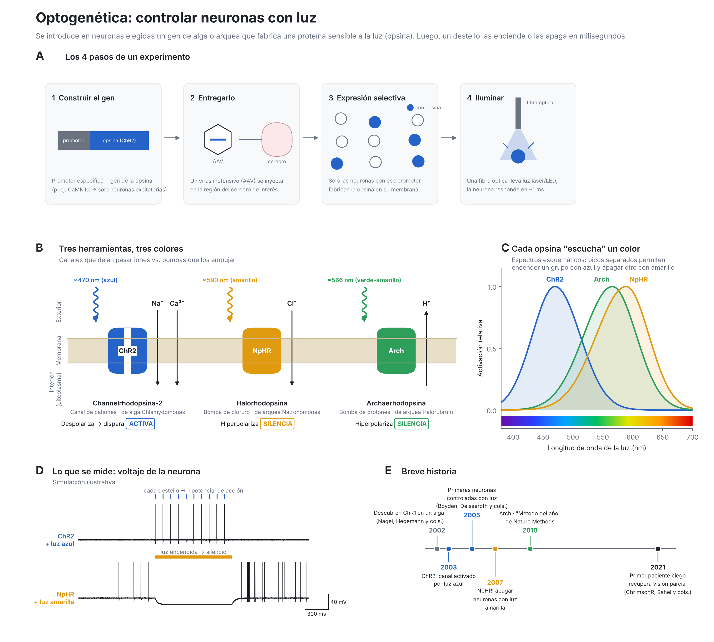

# Optogenética: controlar neuronas con luz

Para regenerarla: `python3 figura_optogenetica.py` (requiere `matplotlib` y `numpy`).

## Cómo leer la figura

**A. Los 4 pasos de un experimento.** Se fusiona el gen de una opsina con un *promotor*: un interruptor genético que solo
se enciende en un tipo de célula. Un virus inofensivo (AAV) lleva ese ADN al cerebro. Solo las neuronas elegidas fabrican la
opsina. Una fibra óptica ilumina la zona.

**B. Tres herramientas.**
- **ChR2 (channelrhodopsina-2)**, de un alga. Es un *canal*: con luz azul (~470 nm) se abre, entran cationes (Na⁺, Ca²⁺)
  y la neurona se despolariza y dispara. Sirve para **activar**.
- **NpHR (halorhodopsina)**, de una arquea. Es una *bomba*: con luz amarilla (~590 nm) mete Cl⁻ a la célula. Esto la
  hiperpolariza, así que la **silencia**.
- **Arch (archaerhodopsina)**, de otra arquea. Es una *bomba*: con luz verde-amarilla (~566 nm) saca H⁺ y también
  **silencia**.

**C. Espectros.** Cada opsina responde a un rango de colores. Como ChR2 (azul) y NpHR (amarillo) tienen picos separados,
se puede activar un grupo de neuronas y apagar otro en el mismo animal. Las curvas son esquemáticas.

**D. Registros (simulados).** Arriba, cada destello azul de 10 Hz produce exactamente un potencial de acción: el control es
de milisegundos. Abajo, una neurona que dispara espontáneamente se calla mientras dura la luz amarilla.

**E. Historia.** 2002–2003: Nagel, Hegemann y colegas describen las channelrhodopsinas. 2005: Boyden, Zhang, Bamberg,
Nagel y Deisseroth controlan neuronas de mamífero con ChR2. 2007: llega NpHR para silenciarlas. 2010: Arch, y
*Nature Methods* nombra a la optogenética “Método del año”. 2021: Sahel y colegas, con ChrimsonR y unas gafas especiales,
devuelven visión parcial a un paciente con retinitis pigmentosa.

## Preguntas para autoevaluarte
1. ¿Por qué hace falta un promotor específico y no basta con iluminar el cerebro?
2. ¿Qué diferencia hay entre un canal (ChR2) y una bomba (NpHR, Arch)? ¿Cuál necesita luz constante para cada ion que mueve?
3. ¿Por qué meter Cl⁻ o sacar H⁺ hace más difícil que la neurona dispare?
4. ¿Qué ventaja tiene la optogenética frente a un electrodo que estimula todo lo que tiene cerca?
